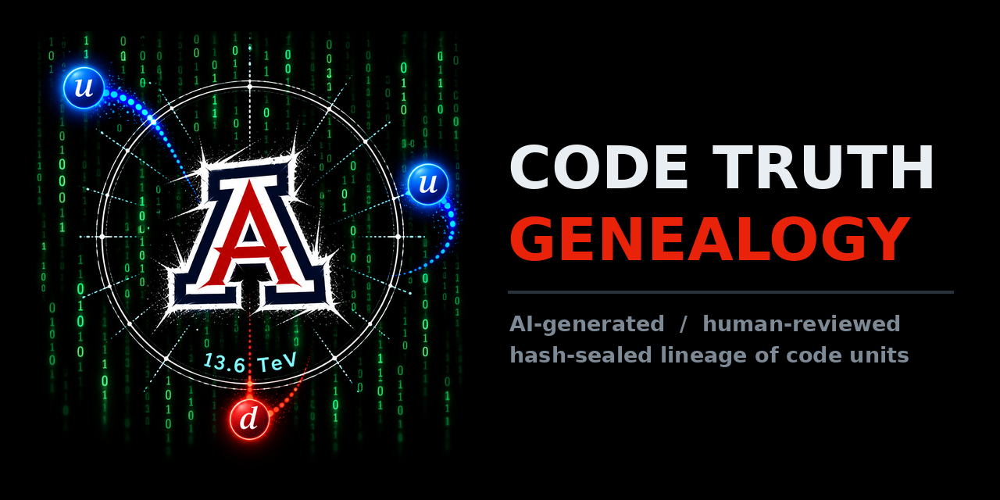

<p align="center"></p>

# code_truth_genealogy

**Live page:** https://n-herling-mk1.github.io/code_truth_genealogy/

A genealogy of ground-truth code: units generated with AI, reviewed by hand, sealed with a sha256,
and kept with their lineage (what came from what, and what changed). Each unit downloads as the raw
file, as a paste-ready prompt, or as a zip of its whole ancestor chain.

## Units

| id | parent | status |
|----|--------|--------|
| `bce_mlp_mk1` | root | DRAFT |
| `disco_mk1` | `bce_mlp_mk1` (variant) | DRAFT |
| `dncn_qn_mk1` | `disco_mk1` (variant) | DRAFT |
| `dnc_flr_mk1` | `disco_mk1` (variant) | DRAFT, experimental |

## Layout

```
units/<id>/     unit.json (hand-edited metadata) + the code, byte-exact, never edited once reviewed
reference/      schema.csv, enums.csv, naming.txt, genealogy_model.txt -- build.py validates against the two .csv
tools/          build.py  scan -> verify -> integrity -> lock -> emit (progress prints)
                seal.py   record a review / re-seal a DRAFT
                render_icons.py  favicon.svg + assets/badge.png -> icon set, header badge, social card
registry/       <id>.json, generated and committed: metadata + sha256 seal (git diff is the audit trail)
docs/           the site: index.html + generated data.js, units/, prompts/, lineage/
assets/         badge.png (full-res original)
```

## Add a unit

1. `units/<slug>_mkN/` with the file(s) and a `unit.json` (copy one, see `reference/schema.csv`).
2. `python tools/build.py` -- first build seals it as DRAFT.
3. Review it, then `python tools/seal.py <id> --status READ --evidence "what was checked"`.
4. `python tools/build.py`, commit, push.

## Integrity

`build.py` re-hashes every file against its seal on every run. A mismatch shows as
**MODIFIED SINCE REVIEW** on the site and the build exits with code 2.
`.gitattributes` sets `* -text` so git never rewrites line endings under the hash.

## Pages

Settings -> Pages -> Deploy from a branch -> `main` / `/docs`.
